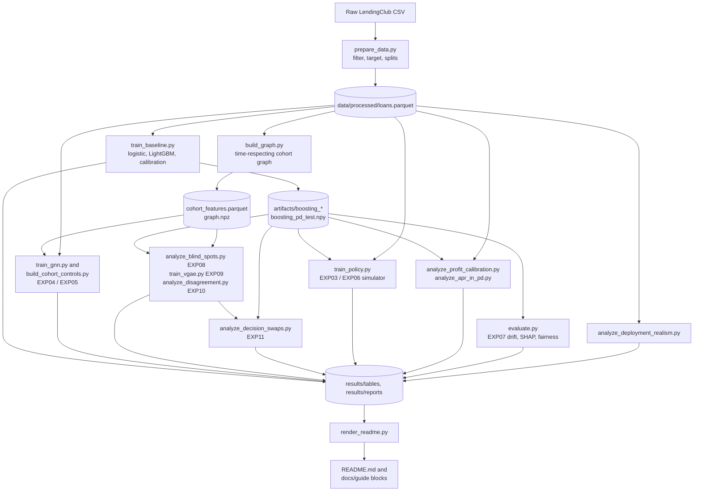

# 02 · Architecture

The system is a pipeline of scripts. Each script reads files written by an earlier one and writes
tables to `results/tables/`, reports to `results/reports/` and (for models and arrays) to
`artifacts/`. The README renders its tables from those files, never from memory
(`scripts/render_readme.py`).

## Components and data flow

The four conceptual layers map onto this picture:

| Layer | Question | Scripts |
|---|---|---|
| A: Risk | How likely is each borrower to default, and is the number trustworthy? | `train_baseline`, `evaluate` |
| B: Graph | Does relational (cohort) information add signal? | `build_graph`, `train_gnn`, `build_cohort_controls` |
| C: Decision | Given PDs and prices, whom should a lender fund? | `train_policy`, `analyze_profit_calibration`, `analyze_apr_in_pd` |
| D: Trust | Where is the model unreliable, and does it drift? | `analyze_blind_spots`, `train_vgae`, `analyze_disagreement`, `analyze_decision_swaps`, `evaluate` |

## Component table

| Component | Responsibility | Inputs | Outputs | Key files |
|---|---|---|---|---|
| Data preparation | Read raw CSV, keep 36-month loans issued 2010-2015, map status to the 0/1 target, compute `outcome_observed_period`, assign splits, write a data profile | raw `accepted_*.csv.gz` | `loans.parquet`, `data_profile.{md,json}` | [`data/prepare.py`](../../src/credit_risk/data/prepare.py), [`data/schema.py`](../../src/credit_risk/data/schema.py), [`data/splits.py`](../../src/credit_risk/data/splits.py) |
| Feature builder | Build decision-time features, refuse forbidden columns, fit encoders on train only | `loans.parquet` | model matrices, `*_features.pkl` | [`features/build.py`](../../src/credit_risk/features/build.py), [`features/financial.py`](../../src/credit_risk/features/financial.py) |
| Graph | Build time-respecting neighbour structure and cohort aggregates | `loans.parquet` | `cohort_features.parquet`, `graph.npz` | [`graph/construction.py`](../../src/credit_risk/graph/construction.py), [`graph/features.py`](../../src/credit_risk/graph/features.py) |
| PD models | Logistic baseline, LightGBM, probability calibration | feature matrices | PDs, calibrator choice | [`models/baseline.py`](../../src/credit_risk/models/baseline.py), [`models/boosting.py`](../../src/credit_risk/models/boosting.py), [`models/calibration.py`](../../src/credit_risk/models/calibration.py) |
| Representation models | GraphSAGE, tabular autoencoder, VGAE | features, graph | embeddings, anomaly and uncertainty scores | [`models/gnn.py`](../../src/credit_risk/models/gnn.py), [`models/autoencoder.py`](../../src/credit_risk/models/autoencoder.py), [`models/vgae.py`](../../src/credit_risk/models/vgae.py) |
| Evaluation | Metrics, bootstrap comparisons, fairness slices, plots | scores, outcomes | metric tables | [`evaluation/`](../../src/credit_risk/evaluation/) |
| Economics and policies | Cashflow model, expected profit, accept/reject rules, audit of predicted vs realised profit | PDs, loans | decisions, audit tables | [`decision/expected_loss.py`](../../src/credit_risk/decision/expected_loss.py), [`decision/policies.py`](../../src/credit_risk/decision/policies.py), [`decision/profit_audit.py`](../../src/credit_risk/decision/profit_audit.py) |
| Blind-spot analysis | Conditional signal test, swap portfolios, placebo controls | PDs, signals, outcomes | KEEP/REJECT decisions, portfolios | [`decision/blindspot.py`](../../src/credit_risk/decision/blindspot.py) |
| Simulator and RL | Replay applicants against a policy at observed exposure; bandits and Q-learning | applicant pool, policy | episode rewards, paired differences | [`simulation/environment.py`](../../src/credit_risk/simulation/environment.py), [`simulation/evaluation.py`](../../src/credit_risk/simulation/evaluation.py), [`rl/`](../../src/credit_risk/rl/) |
| Monitoring and explainability | PSI, prediction and calibration drift, SHAP reason codes | features, scores | drift tables, explanations | [`monitoring/drift.py`](../../src/credit_risk/monitoring/drift.py), [`explainability/`](../../src/credit_risk/explainability/) |
| Rendering | Fill README and guide blocks from artifacts | `results/tables/*` | `README.md`, guide pages | [`scripts/render_readme.py`](../../scripts/render_readme.py) |

## Life of one record

Follow one 36-month loan issued in, say, March 2015.

1. **Raw row.** A line in the LendingClub accepted-loans file with 151 columns, a final
   `loan_status` (for example `Fully Paid`) and post-origination cash columns.
2. **Preparation** ([`prepare_loans`](../../src/credit_risk/data/prepare.py)). The row passes the
   36-month and 2010-2015 filters; `loan_status` maps to `default = 0`; `outcome_observed_period` is
   set to when the outcome was booked; the issue month falls in the test window, so `split = "test"`.
   Later, `test_window_masks` places it in H1 (2015-01…06, used for selection) or H2 (2015-07…12, the
   holdout) by issue month. The post-origination columns stay in the table only to build realised
   cashflows.
3. **Features** ([`FeatureBuilder`](../../src/credit_risk/features/build.py)).
   `assert_no_leakage` rejects any forbidden column; derived ratios (payment to income and similar)
   are added; encoders fitted on training data are applied.
4. **Cohort aggregates** ([`CohortFeatureBuilder`](../../src/credit_risk/graph/features.py)).
   For its ZIP3 and employer cohorts the row gets the smoothed default rate of earlier members
   *whose outcomes had resolved by March 2015*.
5. **Score and calibrate.** LightGBM produces a raw score; the production calibrator (chosen on
   2015-01…06 Brier) maps it to a **PD**, written to `boosting_pd_test.npy`.
6. **Signals.** The autoencoder gives a reconstruction-error score; the disagreement and VGAE
   scores are computed in their own scripts. The EXP08/09/10 tests decide which signals are kept.
7. **Decision.** With its APR and requested amount, the cashflow model gives `y(APR)` and `l(APR)`;
   `expected_profit` and `breakeven_pd` say whether lending is worth it. A policy (threshold,
   expected profit, bandit) turns that into accept or reject at the funded exposure.
8. **Outcome.** In the real-book audit the *actual* repayment (`total_pymnt - fees - funded amount`) is
   charged the same funding and operating cost, so predicted and realised profit can be compared per
   loan. In the simulator the same actual outcome is replayed when a policy approves the loan at the
   funded exposure.
9. **Reporting.** Aggregates over the holdout window flow into `results/tables/`, and
   `render_readme.py` turns them into the README and guide tables.

## Where state lives

| Kind | Location | Tracked in git? |
|---|---|---|
| Raw data | `data/raw/` | no |
| Prepared tables, graph | `data/processed/` | no |
| Trained models, score arrays | `artifacts/` | no |
| Result tables and reports | `results/tables/`, `results/reports/` | **yes** (the README is rendered from them) |
| Figures | `results/figures/` | no (`*.png`, `*.pdf` are ignored) |
| Configs | `configs/` | yes |
